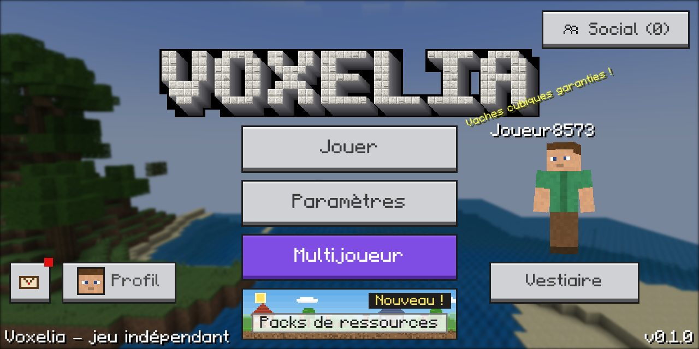
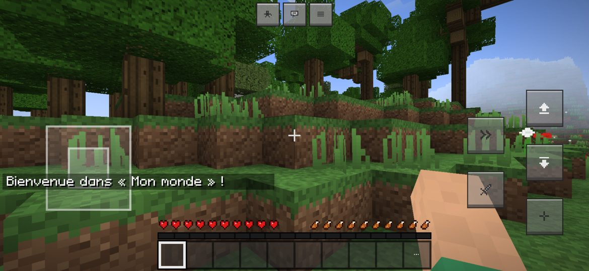
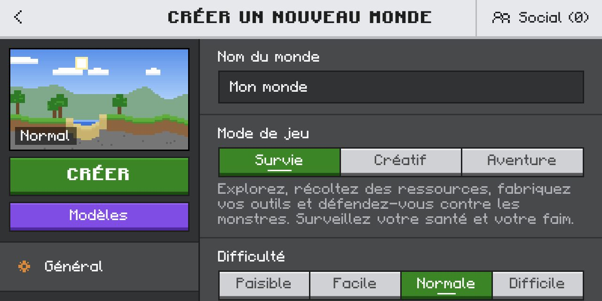
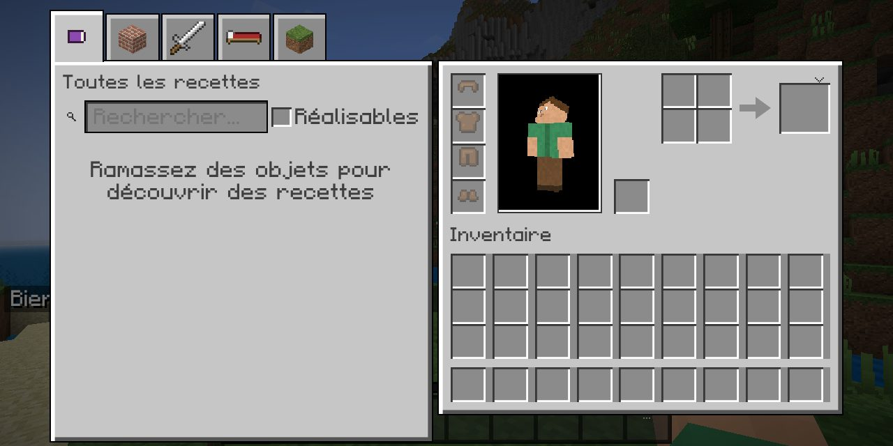

# Voxelia

**Voxelia** est un jeu bac à sable en voxels 3D, **indépendant et original** : exploration d'un monde
procédural infini, construction, survie, artisanat, villages, donjons, boss, trois dimensions et
multijoueur. Il fonctionne sur **PC** (navigateur) et sur **Android** (APK), au clavier/souris, au
tactile et à la manette. L'interface reprend l'ergonomie des menus « à blocs » des jeux du genre
(écran titre, Jouer, création de monde, paramètres, inventaires), avec une police pixel originale.

> Voxelia n'est affilié à aucun autre jeu ni éditeur. Toutes les textures, modèles, sons, musiques
> et la police sont **générés par le code** du jeu. Aucune ressource propriétaire n'est incluse.
> Vous pouvez importer **vos propres packs de textures** sur votre appareil (voir plus bas).

| Écran titre | Partie (tactile) |
| --- | --- |
|  |  |
| **Création de monde** | **Inventaire de survie** |
|  |  |

## Contenu

- **Monde** : génération procédurale par graine, 38 biomes (océans, plaines, forêts, jungle, désert,
  savane, taïga, montagnes, pics enneigés, marais, badlands, volcans, cerisiers, archipels tropicaux,
  biomes fantastiques…), rivières, falaises et surplombs, grottes (« fromage » et « spaghetti »),
  nappes d'eau souterraines, minerais, géodes ; tronçons chargés et déchargés autour du joueur dans
  des workers ; types de monde Normal, Plat, Archipel, Amplifié, Continents.
- **Rendu** : WebGL 2 (Three.js), lumière du ciel et des blocs, occlusion ambiante, cycle jour/nuit
  avec soleil, lune (phases), étoiles et nuages, brouillard, pluie, orages, neige, tempêtes de sable,
  eau et lave animées, élimination des sections invisibles, qualité réglable (bas → ultra).
- **232 blocs**, **410 objets**, **205 recettes** d'artisanat (2×2 et établi 3×3) et **38 cuissons**
  au four ; outils avec durabilité et niveaux de minage, armures, nourriture, seaux, arc, canne à
  pêche, briquet, poudre d'os, houe, carte, boussole, œufs d'apparition.
- **Survie** : vie, faim, saturation, oxygène, armure, effets, dégâts de chute, de feu, de lave, de
  noyade, de cactus, mort et réapparition (lit ou point du monde), expérience, sommeil.
- **Créatures** (42 types) : animaux (reproduction, appât), créatures aquatiques, monstres
  nocturnes et souterrains, villageois avec métiers, emplois du temps et échanges, gardes du
  village, 4 **boss** à phases (Golem antique, Gardien des profondeurs, Souverain des braises,
  Dragon des cieux). IA : errance, fuite, poursuite, attaque au corps à corps ou à distance,
  recherche de chemin.
- **Structures** : villages (5 styles selon le biome), donjons avec générateurs et pièges, crypte
  antique, ruines, temple du désert, cabane de sorcière, camps abandonnés (expérience), sanctuaire
  sous-marin, forteresse des **Terres de braise**, temple du **Royaume céleste**, coffres de butin.
- **Dimensions et portails** : cadre d'obsidienne allumé au briquet (Terres de braise, échelle 1:8),
  cadre de blocs de cristal activé par la clé céleste (Royaume céleste) ; portail de retour construit
  automatiquement.
- **Matériaux des dimensions** : l'**étherium**, minerai rare de la pierre des Terres de braise (pioche
  en diamant requise, fondu en lingots au four), et la **célestine**, gemme rare des îles du Royaume
  céleste. Chacun donne 5 outils, 4 pièces d'armure et un bloc de stockage (9 lingots ou gemmes).
  Ensemble complet d'étherium : insensible au feu (flammes, brûlure, magma), dégâts de la lave
  réduits de moitié. Ensemble complet de célestine : aucun dégât de chute.
- **Véhicules et déplacements** : bateaux, wagonnets et rails (dont rails propulseurs), chevaux à
  apprivoiser et seller, tapis volant, planeur, ascenseurs, vol en mode créatif.
- **Mécanismes** : leviers, boutons, plaques de pression, fils d'énergie, lampes, portes, TNT.
- **Modes** : Survie, Créatif (catalogue par catégories + recherche), Aventure, Spectateur ;
  difficulté Paisible → Difficile ; règles du jeu ; commandes (`/help`, `/time`, `/gamemode`,
  `/tp`, `/give`, `/summon`, `/locate`, `/weather`, `/effect`, `/fill`, `/dimension`…).
- **Audio** procédural (Web Audio) : bruits de pas par matière, blocs, créatures, ambiances
  (pluie, vent, grottes, oiseaux), musique générative jour/nuit/grotte/boss, volumes séparés.
- **Sauvegarde** : IndexedDB, sauvegarde automatique (toutes les 60 s, à la pause, quand
  l'application passe en arrière-plan), écritures atomiques, copie de secours des métadonnées,
  export / import de mondes (`.voxelia`).
- **Multijoueur** : serveur Node.js inclus (`server/`), invitations par code, permissions
  visiteur / membre / opérateur, blocs, coffres, chat et heure synchronisés.

## Jouer sur PC

```bash
cd voxelia
npm install
npm run dev        # puis ouvrir http://localhost:8080
```

| Action | Clavier / souris | Manette |
| --- | --- | --- |
| Se déplacer / sauter / s'accroupir / sprinter | Z Q S D (W A S D) / Espace / Maj / Ctrl | stick gauche / A / B / stick gauche enfoncé |
| Casser / attaquer · Utiliser / poser | clic gauche · clic droit | RT · LT |
| Inventaire · Lâcher · Chat · Commande | E · Q · T · / | Y |
| Vue à la 3ᵉ personne · Débogage · Masquer l'interface · Carte | F5 · F3 · F1 · M | |
| Barre d'accès rapide | 1 à 9, molette | LB / RB |

Toutes les touches se changent dans **Paramètres › Clavier et souris**.

## Jouer sur Android

1. Récupérez `Voxelia.apk` (voir la version publiée, ou compilez-le : [docs/BUILD.md](docs/BUILD.md)).
2. Autorisez l'installation depuis votre gestionnaire de fichiers, puis ouvrez l'APK.
3. Android 7.0 minimum, OpenGL ES 3.0 (WebGL 2) requis ; mode paysage.

Commandes tactiles (comme sur les captures de référence) : joystick carré à gauche, boutons
**sauter**, **s'accroupir**, **sprint**, **attaquer** et **utiliser** à droite ; glisser sur l'écran
pour regarder ; appui court = utiliser, appui long = casser ; boutons caméra / chat / pause en haut ;
case « … » de la barre pour l'inventaire. Taille, opacité, disposition (éditeur par glisser-déposer)
et mode gaucher : **Paramètres › Tactile**.

## Importer un pack de textures

**Paramètres › Packs de ressources › Importer un pack (.zip, .mcpack)** (ou la bannière de
l'écran titre). Les packs au format Java (`assets/minecraft/textures/…`) et Bedrock
(`textures/blocks|items`) sont reconnus : textures de blocs et d'objets, animations (eau, lave,
feu…), et **palettes de couleurs des biomes** (`colormap/grass.png`, `foliage.png`) pour que l'herbe
et le feuillage gardent les bonnes teintes selon le biome. Activez ensuite le pack dans
« Disponibles ». Le pack reste stocké sur votre appareil uniquement.

Exemple mesuré avec un pack 16×16 de 371 textures : 250 des 288 textures de blocs et 116 des 147
icônes d'objets remplacées, palettes de biomes appliquées, import en moins d'une seconde sur PC.
Les blocs propres à Voxelia (mythril, étherium, célestine, portails, blocs célestes…) gardent leurs
textures.

## Multijoueur

Sur un PC du réseau : `npm run server -- --name "Mon serveur" --invite CODE`. Le serveur affiche
son adresse IP. Dans le jeu : **Jouer › Invitations › Rejoindre avec une invitation**.
Toutes les options : [server/README.md](server/README.md).

## Tests

```bash
npm test                # tests unitaires (sauvegarde, recettes, inventaire, collisions, portails, four, matériaux…)
npm run typecheck       # TypeScript (jeu + serveur)
npm run build
npm run e2e             # partie complète dans Chromium sans écran (menu, création, sauvegarde/rechargement, tactile)
npm run gameplay        # miner, ramasser, fabriquer, poser, combattre, bateau, boss, mort, portail, dimensions
npm run materials       # étherium et célestine en survie : minage selon la pioche, four, établi, bonus d'ensemble
npm run server:test     # 60 contrôles du serveur
node tools/multiplayer-test.mjs   # serveur + deux navigateurs : blocs, coffres, chat, reconnexion
```

## Architecture

```
src/
  core/        App (démarrage, navigation, panorama du menu), réglages
  game/        Game (boucle à 20 tics/s), interactions, commandes, portails, explosions, météo, butin
  world/       blocs, biomes, tronçons, lumière, maillage, simulation des blocs, énergie
  world/gen/   génération du terrain, grottes, arbres, structures, dimensions
  workers/     worker de génération et de maillage
  entity/      physique et recherche de chemin ; entities/ : créatures, IA, boss, véhicules
  render/      rendu, textures procédurales, atlas, ciel, effets, main, modèles
  ui/          écrans (titre, Jouer, monde, paramètres, inventaires, pause…), HUD
  input/       clavier, souris, manette, commandes tactiles
  audio/       sons et musique procéduraux
  save/        IndexedDB, sauvegardes, export/import
  packs/       import des packs de ressources
  net/         client et protocole multijoueur
server/        serveur multijoueur (Node.js + ws)
android/       application Android (WebView) et script de compilation sans Gradle
tools/         compilation, tests de bout en bout, outils de vérification
```

## Limites connues

- L'APK est une application **WebView** (le jeu est en TypeScript/WebGL 2) : il a été compilé et
  signé, et le jeu a été testé dans Chromium (même moteur que la WebView Android), mais **pas sur un
  téléphone réel** pendant le développement. Les performances dépendent du GPU ; baissez la
  distance d'affichage ou la qualité si besoin.
- Multijoueur : le monde (blocs, coffres), les joueurs, le chat et l'heure sont synchronisés ;
  **les créatures, objets au sol, projectiles et la météo restent simulés par chaque joueur**.
  Pas d'authentification des noms (protégez le serveur par un code d'invitation).
- Les packs importés remplacent uniquement les textures (pas les modèles 3D, sons, interfaces ni
  les fonctions OptiFine).
- Pas de packs de comportement / scripts, ni de magasin en ligne.
